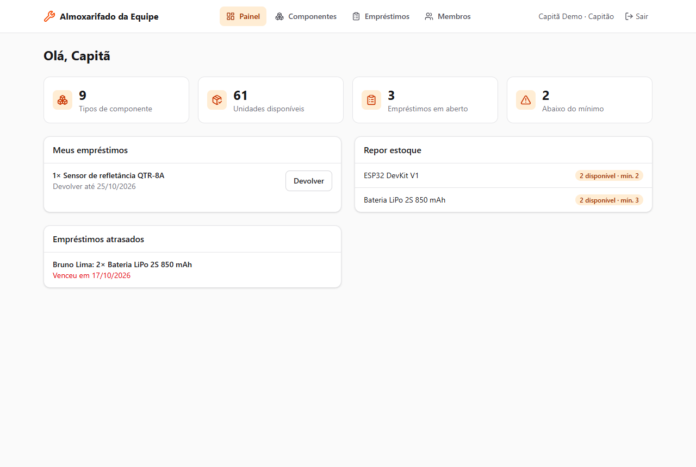
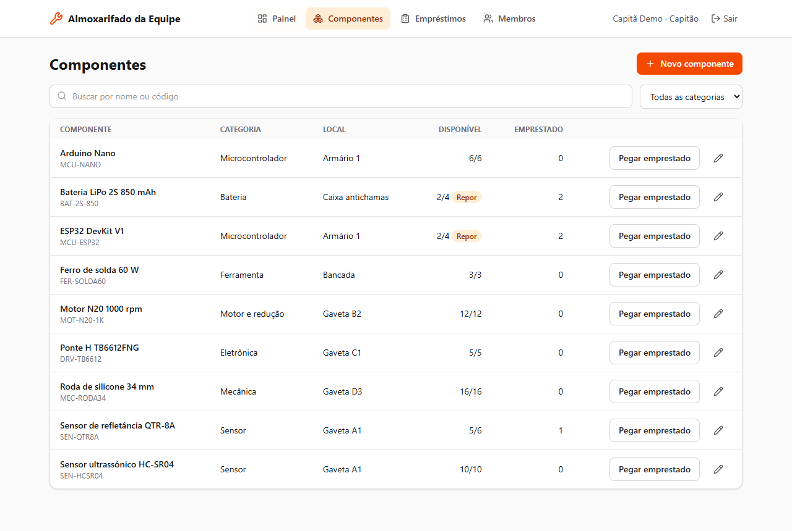
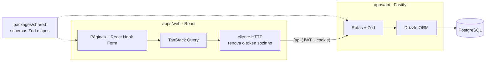

# Almoxarifado da Equipe de Robótica


Sistema web **full stack em TypeScript** para controlar o almoxarifado de uma equipe de robótica: quais componentes existem (sensores, motores, microcontroladores, baterias...), quem pegou o quê emprestado, o que está atrasado e o que precisa ser reposto.

**[Abrir a demonstração](https://kauan-v-marques.github.io/almoxarifado-robotica/)**: entre como capitão ou como membro com um clique. Na demonstração a API é simulada no próprio navegador e os dados são fictícios.

| Painel | Componentes |
|---|---|
|  |  |

## Funcionalidades

- **Login com dois papéis:**
  - o **capitão** cadastra componentes e membros e vê os empréstimos de todos
  - o **membro** pega emprestado e devolve só os próprios itens
- **Estoque:** o disponível é calculado como total menos o que está emprestado, com alerta de estoque mínimo
- **Empréstimos:** com prazo, finalidade e marcação automática de atraso
- **Painel:** resumo, itens para repor, empréstimos do usuário e atrasos da equipe
- **Validação compartilhada:** os mesmos schemas Zod validam os formulários no front e as requisições na API

## Segurança e regras

| O quê | Como |
|---|---|
| Senhas | `scrypt` com salt aleatório (nativo do Node), comparadas em tempo constante |
| Sessão | Access token JWT de **15 min** só na memória do navegador, e refresh token aleatório em cookie **httpOnly + SameSite=Strict** |
| Refresh | **Rotação:** cada refresh token vale uma vez, e no banco fica só o hash SHA-256 dele. O logout revoga o token |
| Força bruta | Limite de tentativas de login por IP, e a mesma mensagem para e-mail inexistente e senha errada |
| Permissões | Rotas do capitão bloqueadas no back-end (403), não só escondidas no front |
| Concorrência | O empréstimo trava a linha do componente (`SELECT ... FOR UPDATE`): dois pedidos simultâneos pela última peça não passam juntos |

## Arquitetura



| Camada | Tecnologias |
|---|---|
| Front-end | React 19, TypeScript, Vite, React Router, TanStack Query, React Hook Form, Zod, Tailwind CSS |
| Back-end | Node.js 24, Fastify 5, Drizzle ORM, PostgreSQL 18, JWT, Zod |
| Testes | Vitest, Testing Library, MSW, PostgreSQL real na API |
| Infra | npm workspaces (monorepo), Docker, nginx, GitHub Actions, GitHub Pages |

```text
apps/api/        API Fastify (rotas, autenticação, banco, migrations SQL)
apps/web/        front-end React (páginas, cliente HTTP, API simulada para a demo)
packages/shared/ schemas de validação e tipos usados pelos dois lados
```

## Como rodar

**Tudo com Docker** (PostgreSQL + API + front com nginx):

```bash
docker compose up --build
```

Depois abra http://localhost:8080 e entre com `capitao@almox.dev` ou `ana@almox.dev` (senha `robotica123`).

**Em modo desenvolvimento:**

```bash
npm install
docker compose up -d db
npm run db:seed                         # migrations + dados de exemplo
JWT_SECRET=um-segredo-com-pelo-menos-32-caracteres npm run dev:api
npm run dev:web                         # http://localhost:5173
```

## Testes

```bash
npm test
```

São 32 testes no total.

**API (21 testes, contra PostgreSQL real):**
- login, validação e mensagem igual para e-mail ou senha errados
- token inválido, rotação e revogação do refresh, limite de tentativas
- permissões de capitão e membro
- cálculo do disponível, empréstimo acima do estoque e devolução por terceiros
- atrasos, cadastro de membros
- **dois empréstimos simultâneos pela última unidade:** só um passa

**Front (11 testes, com MSW simulando a API):**
- validação do formulário e erro do servidor no login
- redirecionamento depois do login para a página pedida
- rotas protegidas
- cadastro, busca e empréstimo de componentes
- renovação automática do token expirado

O GitHub Actions roda lint, tipos, testes (com PostgreSQL 18) e build, constrói as duas imagens Docker e publica a demonstração no GitHub Pages.

---

<details>
<summary>English</summary>

### Robotics Team Parts Inventory

A **full-stack TypeScript** app (React + Fastify + PostgreSQL) to manage a robotics team's parts inventory and loans.

- Role-based access (captain/member), enforced on the API
- Secure auth: scrypt password hashing, 15-minute JWT access tokens kept in memory, rotating refresh tokens in httpOnly SameSite=Strict cookies (only SHA-256 hashes stored), login rate limiting
- Row-level locking prevents concurrent loans from overdrawing stock (covered by a test)
- Shared Zod schemas validate both the forms and the API
- 32 tests (API against real PostgreSQL, front-end with Testing Library + MSW), Docker images, CI and a live demo on GitHub Pages with an in-browser mocked API

</details>
